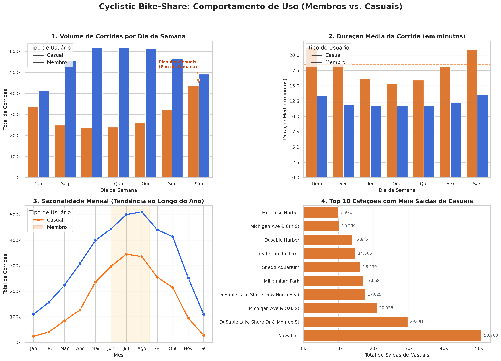

# Estudo de Caso Google: Cyclistic Bike-Share 🚲

[](https://www.python.org/)
[](https://duckdb.org/)
[](https://plotly.com/)
[](https://www.kaggle.com/datasets/marcosfilho12/google-casestudy1-cyclist)

Este repositório apresenta o projeto final do **Estudo de Caso 1** do Certificado Profissional de Análise de Dados do Google (**Google Data Analytics Professional Certificate**).

A empresa analisada é a **Cyclistic**, um serviço de compartilhamento de bicicletas em Chicago com mais de 5.800 bicicletas e 690 estações. O objetivo principal definido pela diretoria de marketing é entender **como os ciclistas casuais e os membros anuais utilizam as bicicletas de maneira diferente**, visando desenhar estratégias para **converter usuários casuais em membros anuais**.

---

## 📌 Metodologia de Análise de Dados do Google

A análise seguiu rigorosamente as 6 fases do ciclo de análise do Google:
1. **Perguntar (Ask)**
2. **Preparar (Prepare)**
3. **Processar (Process)**
4. **Analisar (Analyze)**
5. **Compartilhar (Share)**
6. **Agir (Act)**

---

## 1. ❓ Perguntar (Ask)

### Cenário de Negócio
A diretora de marketing, **Lily Moreno**, acredita que o futuro sucesso da Cyclistic depende da maximização de membros anuais, pois eles são financeiramente muito mais rentáveis a longo prazo do que usuários casuais. Em vez de focar na atração de novos ciclistas, a estratégia mais eficiente é converter a base existente de ciclistas casuais que já conhecem e utilizam a Cyclistic.

### Perguntas Orientadoras
* Como os membros anuais e os ciclistas casuais usam as bicicletas de forma diferente?
* Por que os ciclistas casuais comprariam assinaturas anuais da Cyclistic?
* Como a Cyclistic pode usar a mídia digital e canais diretos para influenciar casuais a se tornarem membros?

---

## 2. 📂 Preparar (Prepare)

* **Fonte dos dados:** Dados públicos históricos de viagens da Cyclistic/Divvy trip data disponibilizados pela Motivate International Inc. sob licença.
* **Volume bruto:** Mais de 6,1 milhões de registros brutos distribuídos em arquivos CSV mensais.
* **Repositório no Kaggle:** Devido ao limite de tamanho do GitHub, a base está disponível publicamente no Kaggle:
  🔗 **[Acessar e Baixar Dataset no Kaggle](https://www.kaggle.com/datasets/marcosfilho12/google-casestudy1-cyclist)**

---

## 3. 🧹 Processar (Process)

O processamento e a auditoria dos dados foram executados com **DuckDB** e **Python**, garantindo alta performance sobre mais de 6 milhões de linhas.

### Regras de Limpeza e Transformação:
1. **Remoção de registros com erro temporal:** Foram eliminadas viagens onde `ended_at <= started_at` (durações negativas ou zero).
2. **Remoção de viagens curtas de teste/manutenção:** Viagens com duração inferior a 60 segundos (onde o usuário apenas destravou e devolveu a bicicleta no mesmo dock por defeito) foram filtradas.
3. **Filtro de anomalias/esquecimentos:** Viagens superiores a 24 horas foram desconsideradas.
4. **Cálculo de métricas essenciais:**
   * `ride_length_min`: Duração da viagem calculada em minutos decimais.
   * `day_of_week` / `dia_nome`: Dia da semana (1 = Domingo, 7 = Sábado).
   * `mes` / `mes_nome`: Mês da corrida para análise de sazonalidade.

**Resultado da auditoria:** **5.951.769 viagens válidas** prontas para a análise.

---

## 4. 🔍 Analisar (Analyze) - Principais Descobertas

| Métrica | Membros Anuais (`member`) | Ciclistas Casuais (`casual`) | Insight Principal |
| :--- | :---: | :---: | :--- |
| **Volume de Corridas** | **3.870.739** (65,0%) | **2.081.030** (35,0%) | Membros representam quase 2/3 de todas as viagens. |
| **Duração Média** | **12,2 min** (Mediana: 8,7 min) | **18,4 min** (Mediana: 11,3 min) | **Casuais passam 50,7% mais tempo pedalando** que membros. |
| **Padrão Semanal** | Terça a Quinta (~618k/dia) | Sábado (438k) e Domingo (335k) | **Membros = comutação/trabalho**; **Casuais = lazer/fim de semana**. |
| **Sazonalidade** | Estável o ano todo (109k a 511k) | Pico massivo no verão (23k Jan ➡️ 345k Jul) | Casuais sobem quase **15x no verão**. |
| **Tipo de Bicicleta** | 67% Elétrica / 33% Clássica | 73% Elétrica / 27% Clássica | Forte preferência mútua por bikes elétricas. |

### Destaques da Análise:
1. **O contraste Trabalho vs. Lazer:** Membros têm pico de uso nos horários e dias de comutação diária de trabalho (segunda a sexta). Casuais têm volume concentrado nas tardes de sábado e domingo.
2. **Duração estendida dos casuais:** Quando utilizam bicicleta clássica, a duração média dos casuais atinge **28,7 minutos** (contra 13,9 minutos dos membros), reforçando o uso recreativo sem pressa.
3. **Hotspots Turísticos:** As estações com maior volume de casuais estão concentradas ao longo da orla do Lago Michigan:
   * **Navy Pier** (#1 com mais de 50.700 partidas)
   * **DuSable Lake Shore Dr & Monroe St** (~29.700 partidas)
   * **Michigan Ave & Oak St** (~20.900 partidas)
   * **Millennium Park** (~17.000 partidas)

---

## 5. 📊 Compartilhar (Share) - Visualização dos Dados

### Painel Executivo Consolidado
O painel abaixo consolida as 4 dimensões cruciais do estudo de caso:



### Dashboard Interativo (`dashboard_interativo.html`)
O repositório inclui um dashboard interativo completo construído com Plotly:
* **Cards de KPIs no topo** com volume total e durações médias.
* **Gráficos interativos** com filtros, tooltips detalhados e zoom.
* **Mapa de Chicago** interativo destacando as estações mais frequentadas pelos ciclistas casuais.

> 💡 **Como abrir:** Basta dar dois cliques no arquivo `dashboard_interativo.html` ou abri-lo em qualquer navegador de internet.

---

## 6. 🚀 Agir (Act) - Recomendações Estratégicas para o Marketing

Com base nas evidências dos dados e no comportamento identificado, sugerem-se **6 ações estratégicas complementares** para a diretora Lily Moreno e a equipe da Cyclistic:

### 1. Bônus de Boas-Vindas e Preço Promocional de Entrada (Período de Degustação)
* **Ação:** Criar uma barreira de entrada muito baixa para o ciclista casual experimentar os benefícios de ser membro.
* **Proposta de Valor:** Oferecer uma condição especial de lançamento, como os **3 primeiros meses por um valor promocional reduzido** (ou 50% a 70% de desconto no primeiro trimestre). 
* **Cashback de Conversão:** Transformar o valor gasto pelo usuário casual em viagens individuais nos últimos 30 dias em **crédito direto** de desconto para abater na anuidade (*"Não perca o que gastou: converta em assinatura"*).

### 2. Parcerias Universitárias e Desconto Estudantil
* **Ação:** Chicago possui uma enorme concentração de estudantes universitários (como DePaul, UIC, Loyola, Columbia College e UChicago), com campi próximos à orla e a corredores cicloviários.
* **Proposta de Valor:** Lançar a categoria **"Cyclistic Universitário"**, oferecendo planos anuais com desconto especial para estudantes mediante comprovação de matrícula. Isso fideliza um público jovem que atualmente utiliza o serviço de forma casual por restrição orçamentária, transformando-os em membros fiéis de longo prazo.

### 3. Campanha Sazonal de Verão (Junho - Agosto)
* **Ação:** Concentrar de 60% a 70% do orçamento de marketing digital entre maio e agosto, período em que o público casual cresce exponencialmente (saltando de 23 mil em janeiro para 345 mil em julho).
* **Oferta:** Lançar uma campanha de "Passe Anual de Verão" antecipada na primavera, incentivando o ciclista casual a garantir a anuidade antes do início dos dias quentes.

### 4. Assinatura Flexível voltada a "Finais de Semana & Lazer"
* **Ação:** Como o uso casual quase dobra aos sábados (438k) e domingos (335k), criar um plano de assinatura específico para fins de semana a um valor atrativo.
* **Gatilho de Upgrade:** Oferecer transição simplificada no aplicativo para o plano anual integral com desconto após o usuário completar 5 passeios de fim de semana.

### 5. Ativações Georreferenciadas nos Hotspots Turísticos
* **Ação:** Instalar totens com QR Codes promocionais e promotores de vendas nas 5 principais estações (Navy Pier, Millennium Park, Lake Shore Dr).
* **Notificações Push no App:** Ao desbloquear uma bicicleta nessas estações de alto fluxo casual, o usuário recebe um alerta de conversão contextualizado com ofertas exclusivas no local.

### 6. Comunicação de "Economia por Tempo Pedalado"
* **Ação:** O ciclista casual passa em média **18,4 minutos por corrida** (chegando a **28,7 minutos** em bikes clássicas), pagando tarifas por minuto ou passe diário que acumulam um custo alto.
* **Campanha no App:** Criar uma calculadora comparativa no aplicativo demonstrando o quanto o ciclista economizaria por minuto e por viagem se migrasse para o plano anual.

### 7. Criação do "Plano Anual Família & Grupos" (Family Pass)
* **Ação:** A análise geográfica revelou que os maiores pontos de saída de casuais são atrações voltadas diretamente ao **lazer familiar e passeios com crianças**, como o **Navy Pier** (1º lugar com mais de 50 mil saídas) e o **Shedd Aquarium** (6º lugar com mais de 16 mil saídas, maior aquário público de Chicago).
* **Proposta de Valor:** Como as assinaturas anuais da Cyclistic são estritamente individuais, uma família de 3 ou 4 pessoas considera financeiramente inviável assinar 4 planos anuais separados, recorrendo a passes avulsos casuais. Lançar uma modalidade de **"Assinatura Família"** (permitindo o desbloqueio de 2 a 4 bicicletas na mesma conta com desconto familiar) oferece uma solução sob medida para converter esses passeios familiares de fim de semana em receitas anuais recorrentes.

---

## 7. 🛡️ Limitações dos Dados e Próximos Passos

* **Privacidade dos Dados (PII):** De acordo com as diretrizes de governança de dados do Google, a base da Cyclistic não inclui dados pessoais identificáveis (PII), tais como nomes, idades, endereço ou composição familiar.
* **Inferência Comportamental:** Embora a presença de famílias e grupos seja fortemente sugerida pelas coordenadas geográficas (atrações familiares como aquários, píeres e parques) e pela duração prolongada nos fins de semana, os dados não categorizam diretamente o estado civil do usuário.
* **Próximo Passo Recomendado:** Realizar uma pesquisa amostral (*in-app survey*) no aplicativo durante os finais de semana de verão no Navy Pier e Shedd Aquarium para mensurar com precisão o tamanho médio dos grupos e validar a adesão ao Plano Família.

---

## 💻 Como Reproduzir Localmente

### 1. Clonar o repositório
```bash
git clone https://github.com/marcosfilhopq/Cyclist.git
cd Cyclist
```

### 2. Configurar o ambiente Python
```bash
python3 -m venv .venv
source .venv/bin/activate
pip install -r requirements.txt # ou: pip install duckdb pandas matplotlib seaborn plotly
```

### 3. Executar as análises e exportar os dados
```bash
python analise.py
```
*Gera o banco `cyclist.db` com as tabelas limpas e exporta os arquivos CSV sumarizados.*

### 4. Gerar o gráfico executivo e o dashboard interativo
```bash
python visualizacao.py            # Gera 'dashboard_cyclistic.png'
python gerar_dashboard_interativo.py  # Gera 'dashboard_interativo.html'
```

---

## 📊 Utilização no Power BI e Kaggle

Os dados foram sumarizados e exportados em arquivos CSV leves e organizados para fácil conexão em ferramentas de Business Intelligence:

* `resumo_dia_semana.csv`: Volume e duração média por dia da semana e tipo de usuário.
* `resumo_meses.csv`: Tendência mensal e sazonalidade.
* `resumo_tipos_bike.csv`: Comparativo de uso de bikes elétricas e clássicas.
* `resumo_top_estacoes.csv`: Top 10 estações casuais com latitude, longitude e volume.
* `resumo_kpis.csv`: Totais gerais e medianas.

### Conectando no Power BI:
1. Abra o **Power BI Desktop**.
2. Clique em **Obter Dados ➡️ Texto/CSV** e selecione os arquivos acima.
3. Crie cartões (Cards) com os KPIs de `resumo_kpis.csv`.
4. Crie gráficos de barras e linhas conectando com `resumo_dia_semana.csv` e `resumo_meses.csv`.
5. Utilize o visual de **Mapa** do Power BI selecionando as colunas `lat`, `lng` e `total_saidas` de `resumo_top_estacoes.csv`.

---

## 👨‍💻 Autor

Desenvolvido por **Marcos Filho**.  
Estudo de caso integrante do **Google Data Analytics Professional Certificate**.

